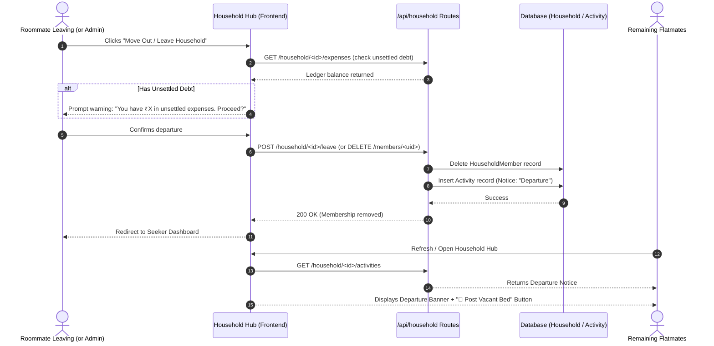

# Seeker Profile & Workflow Enhancement Plan
**RoomiLink AI — Shared Living Platform**

---

## 1. Executive Summary & Overview

This specification documents the required design decisions, architectural updates, and step-by-step code modifications for refining the **Seeker Persona** workflows in RoomiLink AI. 

The primary goals are:
1. **Targeted Experience**: Ensure room seekers only see seeker-relevant membership options and never commercial host/lister pricing.
2. **Seamless Navigation**: Route authenticated room seekers strictly to their personalized Seeker Dashboard upon login or registration.
3. **Peer-to-Peer Spare Room Listings**: Ensure seekers listing an empty bed or spare room in their shared apartment are treated as existing tenant room-sharers, completely removing confusing "Property Owner / Landlord" options.
4. **Transparent Rent Splitting**: Allow seekers to enter total room rent (e.g. ₹16,000) and automatically calculate and display the equal split per roommate (e.g. ₹8,000 / 50% each) across listing inputs, search cards, and room detail pages.
5. **Roommate Departure & Automated Notifications**: Implement an end-to-end roommate departure/removal flow in the Household Workspace that checks unsettled ledger balances, removes membership, and broadcasts an immediate departure notice to all remaining flatmates.

---

## 2. Mandatory vs. Recommended Changes Matrix

| Category | Mandatory Changes | Recommended Enhancements | Impacted Files |
| :--- | :--- | :--- | :--- |
| **1. Pricing Isolation** | • Hide "For Property Hosts & Landlords" tab when `user?.role === "seeker"`.<br>• Show only seeker tiers (`Free Seeker`, `Pro Seeker`). | • Request `/subscriptions/plans?role=seeker` to save payload bandwidth.<br>• Redirect seekers away from explicit `?role=lister` query parameters. | • `frontend/app/pricing/page.tsx`<br>• `frontend/components/Navbar.tsx` |
| **2. Seeker Redirection** | • Redirect `user.role === "seeker"` directly to `/dashboard` on login.<br>• Redirect newly registered seekers to `/dashboard`. | • Update Brand Logo click in Navbar to route authenticated seekers to `/dashboard` instead of `/rooms`. | • `frontend/app/login/page.tsx`<br>• `frontend/app/register/page.tsx`<br>• `frontend/components/Navbar.tsx` |
| **3. Spare Room Listing** | • Remove `🏢 Landlord / Property Owner` option when user is a seeker or URL specifies spare room.<br>• Lock listing purpose to `flatmate_share`. | • Pre-select Twin Sharing (`shared`) room type.<br>• Update "List a Spare Room" CTA button in `/rooms` to link to `?purpose=flatmate_share`. | • `frontend/app/rooms/new/page.tsx`<br>• `frontend/app/rooms/page.tsx` |
| **4. Rent & Split Breakdown** | • Add input for **Total Room Rent** (e.g. ₹16,000).<br>• Calculate and display equal split (e.g. ₹8,000 / month).<br>• Display total rent and roommate split on Room cards & detail page. | • Add `total_room_rent` column to backend `Room` model with dynamic fallback (`rent_amount * max_occupants`).<br>• Add utility split badge. | • `backend/app/models/property_models.py`<br>• `backend/app/routes/room_routes.py`<br>• `frontend/app/rooms/new/page.tsx`<br>• `frontend/app/rooms/page.tsx`<br>• `frontend/app/rooms/[id]/page.tsx` |
| **5. Roommate Departure & Notifications** | • Backend endpoint `POST /api/household/<id>/leave` for self-departure.<br>• Backend endpoint `DELETE /api/household/<id>/members/<user_id>` for admin removal.<br>• Create Household Notice Activity to inform flatmates.<br>• Frontend Departure modal & Notice banner in Household Hub. | • Prevent departure or warn user if they have unsettled debts in expense ledger.<br>• Auto-prompt remaining roommates to "Post Vacant Bed" to find a replacement. | • `backend/app/routes/household_routes.py`<br>• `backend/app/models/household_models.py`<br>• `frontend/app/household/page.tsx` |

---

## 3. Requirement Details & Implementation Specifications

### Requirement 1: Remove Host Pricing for Logged-In Seekers

#### Current Problem
When visiting `/pricing`, all users are presented with a role tab switcher:
- `[For Room Seekers]`
- `[For Property Hosts & Landlords]`

Logged-in seekers can click "For Property Hosts & Landlords" and view commercial host plans (`Basic Lister ₹0`, `Featured Host ₹999`). This creates confusion because seekers cannot create commercial landlord portfolios.

#### Solution
1. In `frontend/app/pricing/page.tsx`:
   - Check `isAuthenticated && user?.role === "seeker"`.
   - If true, hide the role switcher completely.
   - Force `activeTab` to `"seeker"`.
   - Optionally display an informative badge: *"✨ Room Seeker Membership Plans"*.
2. If an unauthenticated user accesses `/pricing`, they may see both tabs. But as soon as they log in as a seeker, host pricing is hidden.

---

### Requirement 2: Strict Login Redirection to Seeker Dashboard

#### Current Problem
Currently in `frontend/app/login/page.tsx`, successful authentication executes:
```tsx
if (result.user?.role === "admin") {
  router.push(redirectParam && redirectParam.startsWith("/admin") ? redirectParam : "/admin");
} else if (redirectParam && !redirectParam.startsWith("/admin")) {
  router.push(redirectParam);
} else {
  router.push("/rooms"); // <--- Problem: Seekers are pushed to Browse Rooms instead of Seeker Dashboard!
}
```

#### Solution
1. In `frontend/app/login/page.tsx`:
   - If `result.user?.role === "seeker"`:
     - Check if `redirectParam` exists and does not lead to admin or invalid pages.
     - Default destination: **`/dashboard`** (Seeker Dashboard).
2. In `frontend/app/register/page.tsx`:
   - On successful seeker registration, redirect to `/dashboard`.
3. In `frontend/components/Navbar.tsx`:
   - Brand logo link:
     ```tsx
     href={isAuthenticated ? (user?.role === "admin" ? "/admin" : user?.role === "seeker" ? "/dashboard" : "/rooms") : "/"}
     ```

---

### Requirement 3: Remove "Property Owner" Option on Add Spare Room

#### Current Problem
In `frontend/app/rooms/new/page.tsx`, a dual-mode selector is displayed at the top:
1. `🏢 Landlord / Property Owner` (Renting out an entire private room, studio, or full property)
2. `🤝 I Live Here & Need a Roommate` (Share Rent & Domestic Bills)

When a seeker clicks "List a Spare Room" (or has `user?.role === "seeker"`), they are given the choice to list as a Landlord. This causes invalid role representations and misconfigured listings.

#### Solution
1. In `frontend/app/rooms/new/page.tsx`:
   - Inspect `user?.role === "seeker"` or query parameter `purpose === "flatmate_share"`.
   - When true:
     - **Remove** the `Landlord / Property Owner` card entirely.
     - Automatically set `listingPurpose = "flatmate_share"`.
     - Render an informative reassurance card:
       > **🤝 Resident Flatmate Space Share**  
       > You are listing a vacant bed or empty room in your flat to share rent and bills with an AI-compatible roommate.
2. In `frontend/app/rooms/page.tsx`:
   - Update the "List a Spare Room" header button:
     ```tsx
     <Link href="/rooms/new?purpose=flatmate_share">
       List a Spare Room
     </Link>
     ```

---

### Requirement 4: Show Actual Room Rent & Calculate Split Between Roommates

#### Current Problem
Currently, the room creation form only has a single ambiguous input: `"Your Share of Rent (₹ INR)"`.
- A seeker does not see what the entire room costs versus what each flatmate pays.
- In `/rooms` and `/rooms/[id]`, users only see one raw number without clear split transparency.

#### Solution
1. **Creation Form (`rooms/new/page.tsx`)**:
   - Provide an input for **Actual Total Room Rent** (e.g. ₹16,000 / month).
   - Provide an input for **Total Roommates Sharing** (default: 2, e.g. twin-sharing).
   - Render a real-time reactive calculation card:
     ```
     ┌─────────────────────────────────────────────────────────────┐
     │ 💡 Rent Division Summary                                    │
     │ Total Room Rent:        ₹16,000 / month                     │
     │ Roommates Sharing:      2 persons                           │
     │ Your Split:             ₹8,000 / month (50%)                │
     │ New Roommate Split:     ₹8,000 / month (50%)                │
     └─────────────────────────────────────────────────────────────┘
     ```
   - Store `rent_amount = 8000` (the per-person payable rent) and `total_room_rent = 16000` (the full room rent).

2. **Backend Database & Model (`property_models.py` & `room_routes.py`)**:
   - Add `total_room_rent = db.Column(db.Float, nullable=True)` to `Room`.
   - In `to_dict()`:
     ```python
     "total_room_rent": self.total_room_rent or (self.rent_amount * (self.max_occupants or 2) if self.listing_purpose == "flatmate_share" else self.rent_amount),
     "split_rent": self.rent_amount
     ```

3. **Browsing & Detail Views (`rooms/page.tsx` & `rooms/[id]/page.tsx`)**:
   - For `listing_purpose === "flatmate_share"`:
     - Highlight: **₹8,000 / mo** *(Your Split)*
     - Subtext badge: **Actual Room Rent: ₹16,000 • 50/50 Split between 2 roommates**

---

### Requirement 5: Roommate Departure / Removal Flow & Real-Time Notification

#### Current Problem
1. There is no route or UI to remove a roommate from a household or allow a roommate to move out.
2. If someone moves out, other roommates are not informed, leaving shared bills, rent, and chores in disarray.

#### Architectural Solution



#### Detailed Backend Implementation
1. **Self Departure Route**: `POST /api/household/<int:household_id>/leave`
   - Validates user is an active member of `household_id`.
   - Checks if user is the sole admin: if yes and other members exist, transfer admin role to the next oldest member.
   - Deletes `HouseholdMember`.
   - Posts a household `Activity`:
     ```python
     notice = Activity(
         household_id=household_id,
         created_by_id=user_id,
         payer_id=user_id,
         title=f"Roommate Departure: {user_name} has moved out",
         description=f"{user_name} has left the household workspace. The room/bed is now vacant.",
         category="Notice",
         total_amount=0.0,
         split_method="equal"
     )
     db.session.add(notice)
     ```
   - Returns success.

2. **Admin Removal Route**: `DELETE /api/household/<int:household_id>/members/<int:target_user_id>`
   - Validates requesting user is household admin.
   - Removes `target_user_id` from `HouseholdMember`.
   - Posts notice: `"{target_name} was removed from the household roster by {admin_name}."`

3. **Informing Remaining Roommates**:
   - In `frontend/app/household/page.tsx`:
     - Highlight recent `"Notice"` activities at the top of the Household Workspace.
     - Provide an immediate action:
       `[📢 Find a Replacement Roommate: List Vacant Bed →]` which opens `/rooms/new?purpose=flatmate_share&source=household`.

---

## 4. File-by-File Blueprint

### 1. `frontend/app/pricing/page.tsx`
- **Lines ~99-122**: Wrap the role tab switcher in `{(!isAuthenticated || user?.role !== "seeker") && ...}`.
- **Lines ~35-51**: Set `activeTab = "seeker"` if `user?.role === "seeker"`.

### 2. `frontend/app/login/page.tsx`
- **Lines ~23-31 & ~61-69**: Check `user.role === "seeker"` and navigate to `/dashboard`.

### 3. `frontend/app/register/page.tsx`
- **Lines ~80-84**: Check `role === "seeker"` and navigate to `/dashboard`.

### 4. `frontend/components/Navbar.tsx`
- **Lines ~27**: Route brand logo to `/dashboard` for logged-in seekers.

### 5. `frontend/app/rooms/new/page.tsx`
- **Lines ~214-273**:
  - Hide the `🏢 Landlord / Property Owner` card if `user?.role === "seeker"` or `purpose === "flatmate_share"`.
  - Default `listingPurpose` to `"flatmate_share"`.
- **Lines ~448-465**:
  - Add `totalRentAmount` state variable.
  - Add reactive calculation: `rentAmount = Math.round(totalRentAmount / maxOccupants)`.
  - Display "Total Room Rent: ₹X" and "Per Roommate Split: ₹Y".

### 6. `backend/app/models/property_models.py` & `backend/app/routes/room_routes.py`
- Add `total_room_rent` to `Room` model.
- Update `create_room()` to store `total_room_rent`.
- Expose `total_room_rent` in room responses.

### 7. `frontend/app/rooms/page.tsx` & `frontend/app/rooms/[id]/page.tsx`
- Update price display to show both total rent and split rent when `listing_purpose === "flatmate_share"`.

### 8. `backend/app/routes/household_routes.py`
- Add `POST /household/<household_id>/leave`.
- Add `DELETE /household/<household_id>/members/<user_id>`.
- Add automatic `Activity` generation with category `"Notice"`.

### 9. `frontend/app/household/page.tsx`
- In the "Roommate Roster" tab (`activeTab === "members"`):
  - Add "Leave Household" button for current user.
  - Add "Remove Member" button for household admin.
  - Add departure confirmation modal with debt alert.
- At the top of Household Hub:
  - Add departure notice banner when a vacancy occurs, with a link to "Post Vacant Bed".

---

## 5. Security & Edge-Case Considerations

1. **Unsettled Balances**:
   - A roommate leaving shouldn't erase their ledger debts. Before leaving, the UI must alert the user of any outstanding amounts (`"You owe ₹X to roommates"`).
2. **Sole Admin Leaving**:
   - If the creator/admin leaves, ownership must be transferred to the next active member. If no members remain, the household can be archived.
3. **Role Enforcement**:
   - Even if someone attempts to manipulate frontend forms, backend `create_room` must ensure seekers cannot create commercial property portfolios without verified lister status.
4. **Data Integrity**:
   - If total rent is ₹15,000 for 2 flatmates, each split is ₹7,500. Round numbers properly without decimal artifacts.

---

## 6. Implementation Readiness Checklist

- [ ] Update `frontend/app/pricing/page.tsx` (Hide host pricing for seekers)
- [ ] Update `frontend/app/login/page.tsx` & `register/page.tsx` (Seeker dashboard redirection)
- [ ] Update `frontend/components/Navbar.tsx` (Logo link for seekers)
- [ ] Update `frontend/app/rooms/new/page.tsx` (Remove property owner option for seekers)
- [ ] Update `frontend/app/rooms/new/page.tsx` (Actual room rent & split calculation)
- [ ] Update `backend/app/models/property_models.py` & `room_routes.py` (`total_room_rent`)
- [ ] Update `frontend/app/rooms/page.tsx` & `rooms/[id]/page.tsx` (Display split breakdown)
- [ ] Update `backend/app/routes/household_routes.py` (Add `/leave` and `/members/<id>` delete)
- [ ] Update `frontend/app/household/page.tsx` (Leave/Remove UI & Departure notice banner)
- [ ] Test end-to-end with unit and integration tests
