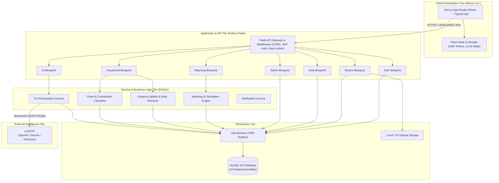
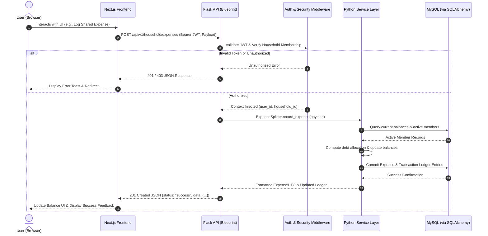
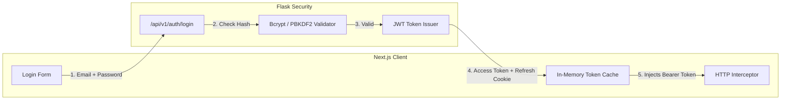
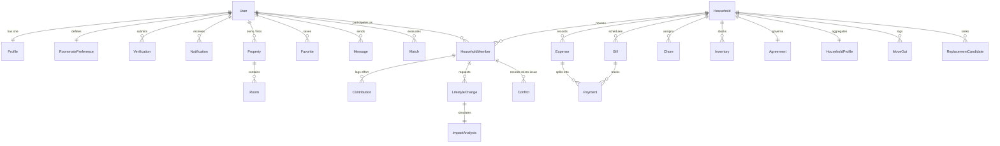
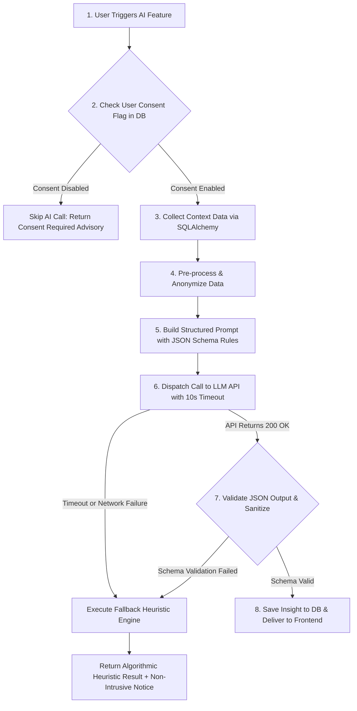
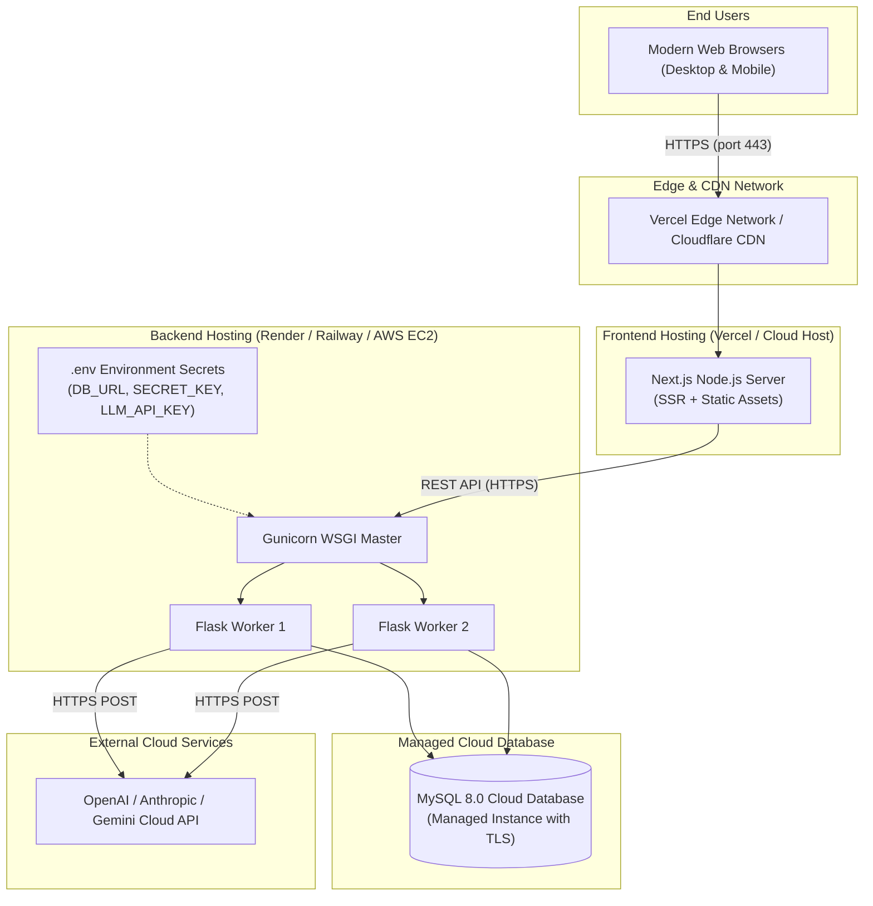

# RoomiLink AI — System Architecture Document

> **Architecture Specification for Decoupled Next.js + Python Flask Application**  
> *Scalable, Secure, and Explainable Infrastructure for Co-Living Search and Ongoing Household Harmony*

---

## 1. Architectural Overview & Adaptation Rationale

### 1.1 High-Level Architectural Vision
**RoomiLink AI** is engineered as a decoupled, service-oriented client-server system. The platform separates concerns across four distinct operational tiers:
1. **Client / Presentation Layer:** A modern, highly responsive Next.js single-page/server-rendered application executing in the user's browser.
2. **Application / API Layer:** A modular Python Flask RESTful API structured via Flask Blueprints that handles request routing, authorization, and data validation.
3. **Domain / Service Layer:** Python business services executing matching logic, financial calculations, chore rotations, and AI prompt orchestration.
4. **Persistence & External Services Layer:** A relational MySQL 8.0 database managed through SQLAlchemy ORM, alongside an external Large Language Model (LLM) API for explainable intelligence.



### 1.2 Architectural Adaptation: Transition from Jinja2 to Next.js + Flask
The initial concept exploratory draft referenced a monolithic Python-only web application using Flask with Jinja2 server-rendered templates and zero client JavaScript. While suitable for simple informational portals, modern shared-living requirements demand:
* Dynamic interactive sliders and filters for roommate lifestyle matching.
* Real-time ledger updates for who owes whom when expenses are split.
* Interactive chore check-offs and drag-and-drop calendars.
* Asynchronous loading states and skeleton indicators during multi-second AI generation tasks without full-page reloads.

**Formal Adaptation Decision:**  
The architecture has been cleanly modernized to a decoupled **Next.js (Frontend) + Python Flask (Backend REST API) + MySQL (Database)** stack. The Flask backend functions as a pure, stateless JSON API provider, allowing clean componentization, frontend framework independence, superior client-side caching, and rapid UI development.

---

## 2. Core System Components

### 2.1 Presentation Layer (Next.js)
* **Framework:** Next.js 14+ using App Router architecture.
* **Component Architecture:** Reusable React components structured into design primitives (buttons, inputs, modals), shared layouts (navigation bar, household sidebar, footer), and domain-specific feature modules.
* **State & Authentication:** Local storage / in-memory authentication state synchronized with secure HTTP-only cookies; centralized API client with automatic bearer token attachment.
* **Styling & Design Tokens:** Vanilla CSS / CSS Modules providing responsive fluid layouts across mobile, tablet, and desktop viewports without vendor lock-in.

### 2.2 Application / API Layer (Python Flask)
* **Framework:** Python Flask 3.x using the Application Factory pattern (`create_app()`).
* **Modular Blueprints:** Independent modules handling cohesive routes:
  * `/api/v1/auth`: Registration, login, token refresh, password management, profile updates.
  * `/api/v1/rooms`: Property and room CRUD, photo uploads, search, filters, favorites.
  * `/api/v1/matching`: Lifestyle preference comparison, candidate search, score breakdown.
  * `/api/v1/chat`: Message retrieval, thread listing, message sending, read status.
  * `/api/v1/household`: Household membership, expenses, debt ledger, recurring bills, chores, inventory, move-out.
  * `/api/v1/ai`: Trigger endpoints for the 8 AI services with consent checks and caching.
  * `/api/v1/admin`: Verification reviews, flagged content queues, user management, audit logs.
* **Security Middleware:** CORS protection via `flask-cors`, JWT validation via `flask-jwt-extended`, request rate limiting, and centralized exception handling.

### 2.3 Service Layer (Business Logic)
* **Decoupled Python Services:** Routes remain thin; complex business rules reside in dedicated domain service classes:
  * `MatchingEngine`: Computes multi-attribute lifestyle distance matrices (sleep, hygiene, social, noise, pets, diet).
  * `ExpenseSplitter`: Computes equal and customized debt allocation; minimizes transactions via graph balancing algorithms.
  * `ChoreContributionService`: Calculates rotating schedules and measures weighted visible and invisible household contributions.
  * `AIService`: Manages user consent verification, context extraction, prompt formatting, API calls with timeouts, JSON parsing, and deterministic fallback logic.

### 2.4 Data Persistence Layer (MySQL & SQLAlchemy)
* **RDBMS:** MySQL 8.0 providing strict ACID transactions, foreign key constraints, and relational consistency.
* **ORM:** Flask-SQLAlchemy with declarative Python models mapping all 24 schema tables.
* **Database Migrations:** Schema versioning via Alembic / Flask-Migrate.

### 2.5 External AI Layer
* **LLM API Client:** Connects to an LLM provider (OpenAI, Google Gemini, or Anthropic) utilizing strict system prompts, JSON mode schemas, and exponential-backoff retries.

---

## 3. End-to-End Request & Response Workflow

A standard request follows a strict unidirectional traversal down through security and service layers, returning structured JSON to the client.



---

## 4. Authentication & Authorization Architecture

### 4.1 Token-Based Authentication Flow
1. **User Credentials:** Client submits email and password over HTTPS to `/api/v1/auth/login`.
2. **Password Verification:** Backend verifies the hash using PBKDF2/bcrypt.
3. **Token Issuance:** Backend returns an **Access Token** (short-lived, 60 minutes) and sets a **Refresh Token** (long-lived, 30 days) in a secure, HTTP-only cookie.
4. **Subsequent API Requests:** Next.js attaches the Access Token in the HTTP `Authorization: Bearer <token>` header.
5. **Session Expiry & Silent Refresh:** When an access token expires, an Axios/Fetch interceptor automatically invokes `/api/v1/auth/refresh` to obtain a fresh token seamlessly.



### 4.2 Role-Based Access Control (RBAC)
Endpoints enforce authorization through Python decorators:
* `@jwt_required()`: Ensures caller has a valid, non-expired token.
* `@role_required(['admin'])`: Restricts endpoints (such as verification approvals or ban actions) to platform administrators.
* `@household_member_required`: Verifies the caller is an active participant in the requested household, preventing unauthorized data leakage between different shared homes.

---

## 5. Frontend & Backend API Communication Standards

All network communication between Next.js and Flask adheres to strict REST conventions:
* **Protocol:** HTTPS with JSON request and response payloads.
* **Base URL:** `/api/v1/`
* **HTTP Methods:**
  * `GET`: Idempotent data retrieval (with query string filtering, e.g., `?budget_max=1200&city=Austin`).
  * `POST`: Entity creation and action triggering.
  * `PUT` / `PATCH`: Entity updates.
  * `DELETE`: Entity removal / soft-deletion.
* **Standard JSON Response Envelope:**
```json
{
  "status": "success",
  "data": { ... },
  "message": "Optional human-readable feedback"
}
```
* **Standard JSON Error Envelope:**
```json
{
  "status": "error",
  "code": "HOUSEHOLD_NOT_FOUND",
  "message": "The specified household does not exist or access is forbidden.",
  "details": []
}
```

---

## 6. Database Architecture & Relational Schema (24 Entities)

The RoomiLink AI database consists of **24 core relational entities** organized across four foundational domains, ensuring referential integrity, indexed querying, and historical auditability.



### 6.1 Domain 1: Users & Trust (5 Entities)
1. **`User`:** Core authentication record (`id`, `email`, `password_hash`, `role`, `is_active`, `is_verified`, `ai_consent_enabled`, `created_at`).
2. **`Profile`:** Personal bio details (`id`, `user_id`, `full_name`, `age`, `gender`, `occupation`, `institution`, `city`, `avatar_url`, `bio`).
3. **`RoommatePreference`:** Lifestyle parameters (`id`, `user_id`, `sleep_schedule`, `cleanliness_level`, `smoking_status`, `drinking_status`, `guest_frequency`, `noise_tolerance`, `dietary_pref`, `work_routine`, `pet_tolerance`, `budget_min`, `budget_max`).
4. **`Verification`:** Trust documentation (`id`, `user_id`, `doc_type`, `doc_url`, `status` [pending, approved, rejected], `reviewer_id`, `submitted_at`, `reviewed_at`).
5. **`Notification`:** System events (`id`, `user_id`, `title`, `body`, `type`, `is_read`, `action_url`, `created_at`).

### 6.2 Domain 2: Search & Match (5 Entities)
6. **`Property`:** Real estate entity (`id`, `lister_id`, `title`, `description`, `address`, `city`, `neighborhood`, `property_type`, `total_rooms`, `created_at`).
7. **`Room`:** Individual rentable space (`id`, `property_id`, `room_type` [private, shared, master], `rent_amount`, `deposit_amount`, `is_available`, `available_from`, `amenities_json`, `images_json`).
8. **`Match`:** Pairwise compatibility record (`id`, `user_a_id`, `user_b_id`, `score`, `strengths_json`, `friction_points_json`, `calculated_at`).
9. **`Favorite`:** Saved bookmarks (`id`, `user_id`, `property_id`, `created_at`).
10. **`Message`:** Communication records (`id`, `sender_id`, `receiver_id`, `content`, `is_read`, `created_at`).

### 6.3 Domain 3: Household Management (9 Entities)
11. **`Household`:** Co-living collective entity (`id`, `name`, `address`, `invite_code`, `created_by`, `status` [active, archived], `created_at`).
12. **`HouseholdMember`:** Membership roster (`id`, `household_id`, `user_id`, `role` [admin, member], `move_in_date`, `rent_share_percentage`, `status` [active, moved_out]).
13. **`Expense`:** Shared financial expenditure (`id`, `household_id`, `payer_id`, `title`, `amount`, `category`, `split_type` [equal, custom], `created_at`).
14. **`Bill`:** Recurring scheduled charges (`id`, `household_id`, `title`, `amount`, `due_date`, `frequency` [monthly, quarterly], `status` [pending, paid]).
15. **`Payment`:** Split debt settlements (`id`, `expense_id`, `bill_id`, `from_user_id`, `to_user_id`, `amount`, `status` [pending, settled], `settled_at`).
16. **`Chore`:** Domestic task assignments (`id`, `household_id`, `assigned_to_id`, `title`, `description`, `frequency`, `due_date`, `is_completed`, `completed_at`, `effort_weight`).
17. **`Inventory`:** Shared household supplies (`id`, `household_id`, `item_name`, `quantity`, `threshold`, `status` [in_stock, low, out_of_stock], `updated_by`).
18. **`Agreement`:** Living rules document (`id`, `household_id`, `version`, `clauses_json`, `is_active`, `signed_members_json`, `updated_at`).
19. **`MoveOut`:** Departure record (`id`, `household_id`, `user_id`, `notice_date`, `departure_date`, `cleared_financials`, `cleared_chores`, `status`).

### 6.4 Domain 4: AI Insights & Dynamics (5 Entities)
20. **`HouseholdProfile`:** Composite vector of the home (`id`, `household_id`, `avg_cleanliness`, `dominant_sleep_pattern`, `noise_norm`, `guest_tolerance_score`, `updated_at`).
21. **`Contribution`:** Visible and invisible labor logs (`id`, `household_id`, `member_id`, `task_type` [chore, errand, coordination, financial], `effort_points`, `description`, `logged_at`).
22. **`LifestyleChange`:** Proposed occupant change (`id`, `household_id`, `member_id`, `change_type` [job_hours, pet, new_guest], `details`, `status` [proposed, simulated, accepted, rejected]).
23. **`ImpactAnalysis`:** Simulation result (`id`, `lifestyle_change_id`, `overall_risk_level`, `per_member_impact_json`, `suggested_mitigations_json`, `created_at`).
24. **`Conflict`:** Voluntary micro-issue entries (`id`, `household_id`, `reporter_id`, `category` [noise, chores, bills, privacy], `severity`, `description`, `created_at`).
*(Note: Replacement candidates are stored as `ReplacementCandidate` records linking `household_id` to candidate `user_id` with ranking scores).*

---

## 7. AI Request Workflow, Consent, Error Handling & Fallbacks

RoomiLink AI enforces an 8-stage pipeline ensuring data privacy, schema compliance, and zero downtime.



### 7.1 Detailed 8-Stage Pipeline
1. **User Action:** User initiates an analysis (e.g., clicking *"Predict Conflicts"*, *"Analyze Proposed Change"*, or scheduled daily drift monitor).
2. **Consent Check:** System inspects `User.ai_consent_enabled`. If disabled, the AI operation terminates immediately with an informative banner.
3. **Data Collection:** SQLAlchemy queries relevant domestic parameters (chore completion ratios, lifestyle vectors, payment timelines).
4. **Pre-processing:** Data is cleaned, sensitive PII (real email, phone number, financial banking details) is stripped, and metrics are normalized.
5. **Prompt Construction:** Python AI Service constructs a deterministic prompt enforcing strict markdown-fenced or direct JSON schemas.
6. **LLM API Invocation:** Call dispatched to LLM API with an explicit **10-second timeout** and exponential backoff retry (max 2 attempts).
7. **Output Validation:** Response string is parsed via Python's `json.loads()` and validated against expected keys (`score`, `strengths`, `risks`, `reasoning`).
8. **Persistence & Presentation:** Validated results are stored in appropriate domain tables (e.g., `ImpactAnalysis`) and returned as JSON to Next.js.

### 7.2 Graceful Degradation & Fallback Behavior
AI capabilities are designed as advisory enhancements that layer on top of core features:
* **Compatibility Fallback:** If the LLM API is unavailable, the `MatchingEngine` computes an algorithmic Euclidean distance score across lifestyle numbers (0–100%) and outputs predefined template explanations based on divergent dimensions.
* **Agreement Fallback:** If agreement generation fails, the system outputs the standard platform Co-Living Template populated with the roommates' explicit preference answers.
* **Drift & Problem Fallback:** If pattern inference times out, the system displays mathematical variance metrics directly (e.g., *"3 chores were marked completed >48 hours late this month"*).
* Under all failure scenarios, the core application remains 100% operational, and the user is informed with a polite indicator: *"AI service currently operating in standard algorithmic mode."*

---

## 8. Deployment Architecture



### 8.1 Development Environment (Local Windows Setup)
* **Frontend:** Next.js development server running on `http://localhost:3000`.
* **Backend:** Flask development server executing within a Python virtual environment (`.venv`) on `http://127.0.0.1:5000`.
* **Database:** Local MySQL 8.0 server (port 3306) or fallback local SQLite database for zero-configuration rapid testing.
* **CORS:** Configured in Flask to accept requests from `http://localhost:3000`.

### 8.2 Production Deployment Setup
* **Frontend:** Next.js application built via `npm run build` and deployed to Vercel or a cloud Node.js container, utilizing automatic SSL and global CDN distribution.
* **Backend:** Flask application served using a production WSGI HTTP server (**Gunicorn**) with multiple asynchronous workers, deployed on a platform such as Render, Railway, or AWS EC2.
* **Database:** Managed MySQL 8.0 instance (AWS RDS, PlanetScale, or Railway MySQL) with automated daily backups, foreign keys enabled, and connection pooling.
* **Security & Environment Variables:** All secrets (`JWT_SECRET_KEY`, `DATABASE_URL`, `LLM_API_KEY`) configured strictly in host environment secret managers, never committed to git repositories.
